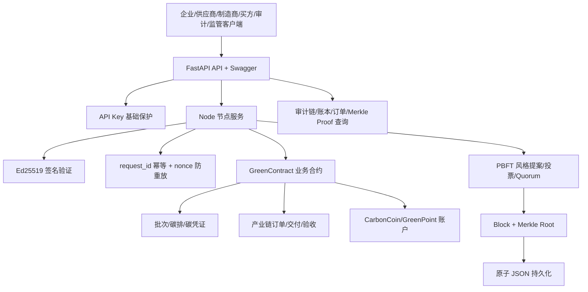

# GreenTrace：绿色产业链可信协同平台

GreenTrace 是一个面向绿色供应链、碳排放核验和产业链协同的**可运行联盟链仿真平台**。它把组织身份、供应链批次、碳排数据、第三方审计、碳凭证、产业链订单、演示型 CarbonCoin 结算、GreenPoint 激励和监管审计放在同一条可验证的业务链路上。

它不是只演示“把字符串做一次 SHA-256 哈希”，也不是单一的碳凭证交易页面，而是一个可以运行、测试、演示和继续生产化演进的多模块 Python 项目。

> **重要边界**：本项目目前是教学/竞赛级联盟链仿真平台和生产化基础原型。它不构成真实碳信用交易所、支付系统、证券系统或法定货币系统。`CarbonCoin` 与 `GreenPoint` 仅为本地仿真记账单位，不可提现、不可兑换现实货币，也不代表任何投资收益。

### 安全边界与兼容性说明（当前版本）

共识投票是**单进程模拟**：票据由本地生成并持久化的验证人密钥做 Ed25519 签名，外部进程不能仅凭公开哈希伪造票据；但四个验证人密钥由同一进程生成、同一目录保管，因此仍不代表跨主机网络共识，也不具备拜占庭容错。`verify_full()` 会校验区块链、交易签名、Merkle 域分隔、历史 nonce/request-id 和票据签名。生产部署必须替换为真实的多机验证节点身份与网络协议。

组织、成员和治理状态不再接受 API 的无签名直接修改，必须提交 `governance_*` 签名交易，因而这是一个有意的 breaking change。`GREENTRACE_DATA_DIR`、`GREENTRACE_LOG_LEVEL` 分别控制持久化目录和日志级别。碳量使用精确到 `0.001 kg` 的 `Decimal` 量化，金额继续使用整数最小单位。

---

## 目录

- [1. 项目定位](#1-项目定位)
- [2. 平台解决的问题](#2-平台解决的问题)
- [3. 参与角色](#3-参与角色)
- [4. 完整业务闭环](#4-完整业务闭环)
- [5. 系统架构](#5-系统架构)
- [6. 核心能力](#6-核心能力)
- [7. 资产与订单模型](#7-资产与订单模型)
- [8. 可信与安全逻辑](#8-可信与安全逻辑)
- [9. 项目结构](#9-项目结构)
- [10. 快速启动](#10-快速启动)
- [11. CLI 演示](#11-cli-演示)
- [12. 启动 API 与 Swagger](#12-启动-api-与-swagger)
- [13. API 接口说明](#13-api-接口说明)
- [14. 签名交易示例](#14-签名交易示例)
- [15. 产业链订单示例](#15-产业链订单示例)
- [16. 测试与验证](#16-测试与验证)
- [17. 持久化与恢复](#17-持久化与恢复)
- [18. 与普通哈希链 Demo 的区别](#18-与普通哈希链-demo-的区别)
- [19. 当前限制](#19-当前限制)
- [20. 生产化路线](#20-生产化路线)
- [21. 适用对象](#21-适用对象)

---

## 1. 项目定位

GreenTrace 的核心目标是验证下面这条完整链路：

```text
参与方身份
    ↓
签名交易
    ↓
组织和角色授权
    ↓
碳排/订单/资产业务规则
    ↓
PBFT 风格节点投票
    ↓
区块与 Merkle Root
    ↓
业务状态变更
    ↓
审计事件与交易回执
    ↓
持久化、查询和状态重建
```

平台可以回答：

- 这笔交易是谁提交的？
- 发送者有没有组织成员资格？
- 交易内容是否被修改？
- 这个批次是否提交过同一版本？
- 审计者是否审核了自己的数据？
- 这批碳凭证是否已经转移、冻结、撤销或退休？
- 订单是否已经交付和验收？
- CarbonCoin 是否被重复扣款？
- 某笔交易是否被共识节点接收？
- 某笔交易是否属于某个区块？
- 当前账本能否从区块历史重新构建？

---

## 2. 平台解决的问题

传统绿色供应链往往由多个系统拼接而成：

```text
供应商 Excel
    + 企业采购系统
    + 审计 PDF
    + 物流交付系统
    + 财务结算系统
    + 监管报表
```

这种模式容易产生：

1. 数据口径不一致；
2. 碳排版本无法追踪；
3. 审计记录分散；
4. 凭证流转过程不透明；
5. 同一额度被重复使用；
6. 订单、交付和碳数据互相脱节；
7. 出现争议时难以还原完整过程。

GreenTrace 用统一的追加式账本把这些动作串联起来：

```text
组织准入
  → 批次登记
  → 碳排上报
  → 独立审计
  → 凭证生成
  → 订单创建
  → 供应链交付
  → 买方验收
  → CarbonCoin 结算
  → GreenPoint 激励
  → 凭证转移、退休、冻结或撤销
```

---

## 3. 参与角色

| 角色 | 主要职责 | 典型操作 |
|---|---|---|
| `enterprise` | 企业或生产方 | 登记批次、提交碳排数据、转移/退休凭证 |
| `supplier` | 上游供应商 | 登记材料批次、提交数据、确认订单、交付订单 |
| `manufacturer` | 制造或加工企业 | 参与产业链、确认生产/交付环节 |
| `brand` | 品牌方 | 创建采购订单、接收产业链交付 |
| `buyer` | 买方 | 创建订单、验收订单、触发结算 |
| `auditor` | 独立审计机构 | 审核碳排数据、提交审计结果 |
| `regulator` | 监管机构 | 冻结/解冻账户、冻结/撤销碳凭证 |
| `issuer` | 仿真资产发行方 | 在演示环境发放 CarbonCoin |
| `admin` | 联盟管理员 | 管理演示环境中的多类操作 |

角色不是用户输入一段文字就自动生效，而是由组织成员凭证和服务端合约共同检查。

---

## 4. 完整业务闭环

### 4.1 组织与成员准入

### 4.4 常见异常场景覆盖

| 场景 | 状态/结果 | 处理规则 | 证据/API |
|---|---|---|---|
| 成员邀请、接受/拒绝、过期、撤销 | `invited` → `accepted`/`rejected`/`revoked` | 待接受凭证不可交易；过期或重复决定拒绝 | `member.invited`、`/organizations/members/invite`、`/organizations/members/decision` |
| 组织停用 | `active=false` | 组织成员全部交易拒绝 | `organization.deactivated`、`/organizations/deactivate` |
| 碳数据缺字段/证据哈希不一致 | 交易拒绝 | `version`、`evidence_hash` 必填；提供 evidence 时校验哈希 | rejected trace、`/carbon-data` |
| 碳数据重复版本、退回整改、复核、驳回 | `submitted`/`rework_required`/`approved`/`rejected` | 已批准版本不可替换；版本号不可重复 | batch timeline、`/batches/{id}/timeline` |
| 批次冻结、解冻、撤销 | `frozen`/`revoked` | 冻结或撤销后不可转移/退休，解冻不能恢复撤销 | `freeze_credits`/`unfreeze_credits`/`revoke_credits` |
| 订单取消、供应商拒绝、确认超时、延期 | `cancel`/`supplier_rejected`/`delayed` | 状态机限制动作；超 confirmation_deadline 拒绝 | order trace、`/supply-chain/orders/{id}/actions` |
| 部分/多次交付、质量不合格、部分验收、拒收 | `partial_delivery`/`delivered`/`partial_accept`/`rejected` | 累计交付和验收均不得超过订单量；拒收需理由 | 订单 events/evidence_hash |
| 争议与监管裁决 | `dispute` → `resolved` | 争议需证据哈希，仅 regulator/admin 可裁决 | `/orders/{id}/timeline` |
| 退款/部分退款、重复动作 | escrow 余额递减至零 | 退款和结算以 escrow 余额为上限，重复请求拒绝 | ledger、`/accounts/{address}/funds-flow` |
| 托管、锁定、释放、余额不足、冻结/解冻 | escrow/balance 状态 | 借方余额不足或冻结账户交易拒绝 | ledger、`/accounts/{address}` |
| 重复扣款、奖励幂等 | 单笔 ledger/reward key | request_id、nonce 和 reward key 防重放 | transaction trace、`/transactions/{request_id}` |
| 失败交易、状态重建、持久化回滚、链篡改 | rejected / rebuilt / invalid | 失败转换原子回滚；从区块重放；校验 hash/Merkle | `/integrity`、`/integrity/rebuild`、`/audit-chain` |

1. 创建企业、供应商、审计机构等组织；
2. 为组织添加成员；
3. 为成员分配角色；
4. 设置成员凭证有效期；
5. 必要时撤销成员资格；
6. 每个成员使用自己的 Ed25519 地址提交交易。

### 4.2 碳数据与凭证

1. 企业或供应商登记供应链批次；
2. 提交碳排数据版本；
3. 链下保存原始文件，链上保存文件哈希；
4. 审计机构独立核验；
5. 审核通过后，批次进入可流转状态；
6. 凭证可以转移、退休、冻结或撤销；
7. 每一个状态变化都追加一笔交易，历史不会被直接删除。

### 4.3 产业链订单

订单典型路径：

```text
买方创建订单
    ↓
供应商确认
    ↓
供应商或制造商交付
    ↓
买方验收
    ↓
CarbonCoin 自动结算
    ↓
按时交付奖励 GreenPoint
```

订单状态：

```text
created → acknowledged → delivered → accepted → settled
```

平台拒绝跳过状态、重复验收和重复结算。

### 4.4 激励和监管

- 审计通过：审计机构获得 GreenPoint；
- 低碳批次：批次所有者获得 GreenPoint；
- 按时交付：供应商获得 GreenPoint；
- 余额不足：结算失败；
- 账户冻结：禁止代币转账；
- 凭证冻结：禁止凭证流转和退休；
- 凭证撤销：凭证永久失效，但历史仍可查询。

---

## 5. 系统架构



### 5.1 节点与共识

默认模拟 4 个验证节点：

```text
n = 4
f = (n - 1) // 3 = 1
quorum = 2f + 1 = 3
```

一个区块至少需要 3 个验证节点对同一个区块哈希投票，才允许提交。

### 5.2 链上与链下

链上保存：

- 规范化交易摘要；
- 交易签名和公钥；
- 碳排数据摘要；
- 原始证明文件哈希；
- 订单状态；
- 代币账本；
- 审计事件；
- 区块哈希；
- Merkle Root；
- 节点投票结果。

链下保存：

- 原始报告；
- 原始检测文件；
- 图片、PDF、传感器原始数据；
- 大型附件；
- 企业内部财务和生产明细。

链上记录文件哈希，用于证明链下文件在之后是否被替换。

---

## 6. 核心能力

### 6.1 Ed25519 交易签名

交易签名覆盖除签名字段和公钥字段之外的规范化 JSON 内容。节点验证：

1. 签名是否有效；
2. 公钥是否能推导出 `sender`；
3. 发送者 nonce 是否正确；
4. 发送者是否拥有当前动作权限。

### 6.2 Canonical JSON 与 SHA-256

同一份业务数据必须被编码成同一字节序列，才能保证不同节点计算出同一个哈希：

```text
排序字段
  → 固定 JSON 分隔符
  → UTF-8 编码
  → SHA-256
```

### 6.3 区块和 Merkle Proof

每个区块包含：

- 区块高度；
- 前一区块哈希；
- 提议者；
- 时间戳；
- 交易列表；
- Merkle Root；
- 区块哈希；
- 验证节点投票。

如果篡改一笔交易，会导致：

```text
交易哈希变化
  → Merkle Root 变化
  → 区块哈希变化
  → 后续 previous_hash 不匹配
  → 完整性检查失败
```

### 6.4 业务合约

业务规则只在服务端执行，客户端不能直接修改余额或状态。主要规则包括：

- 已存在批次不能重复登记；
- 同一碳排版本不能重复提交；
- 审计机构不能审核自己提交的批次；
- 未审核凭证不能转移；
- 已冻结或撤销凭证不能转移；
- 转移金额不能超过剩余额度；
- 退休额度不能再次使用；
- 订单必须按状态机推进；
- 订单不能重复结算；
- 余额不足不能支付；
- 冻结账户不能转账；
- 奖励使用唯一奖励键，不能重复发放。

### 6.5 组织和成员凭证

成员支持：

- 组织归属；
- 角色；
- 激活状态；
- 凭证版本；
- 过期时间；
- 主动撤销。

### 6.6 审计与恢复

平台记录：

- 组织创建；
- 成员签发；
- 成员撤销；
- 交易提交；
- 订单结算；
- 代币铸造和转账；
- 奖励发放；
- 凭证冻结和撤销。

如果状态文件丢失，`Node.rebuild_state()` 会重新读取区块交易，重建：

- 批次；
- 凭证余额；
- 代币账户；
- 账本；
- 订单；
- nonce；
- 交易回执。

---

## 7. 资产与订单模型

### 7.1 碳凭证

碳凭证是对经过业务审核的额度进行数字化记录，核心字段包括：

```text
batch_id
carbon_kg
remaining_credits
retired_credits
owner
audited
frozen
revoked
status
evidence_hash
```

凭证状态：

| 状态 | 含义 | 是否可转移 |
|---|---|---|
| `active` | 正常可用 | 视审计和余额而定 |
| `frozen` | 暂停使用，等待调查 | 否 |
| `revoked` | 被监管撤销 | 否 |
| `retired` | 已退休/注销 | 否 |

### 7.2 CarbonCoin

CarbonCoin 是演示型内部结算单位，可用于：

- 订单支付；
- 产业链业务记账；
- 自动结算流程演示；
- 余额和账本测试。

它不是：

- 法定货币；
- 银行存款；
- 真实稳定币；
- 证券；
- 可提现支付工具；
- 真实碳配额或碳信用。

### 7.3 GreenPoint

GreenPoint 是绿色贡献积分，用于：

- 审计通过奖励；
- 低碳批次奖励；
- 按时交付奖励；
- 绿色产业链贡献评价。

### 7.4 订单

订单核心字段：

```text
order_id
supplier
manufacturer
buyer
amount
token
status
settled
```

订单结算是原子业务动作：只有验收通过且余额足够，才会同时完成付款方扣款和供应商收款。

---

## 8. 可信与安全逻辑

### 8.1 request_id 幂等

同一个请求重复提交：

```text
内容相同 → 返回原交易回执，不重复执行
内容不同 → 拒绝，防止 request_id 被复用
```

### 8.2 nonce 防重放

每个发送者单独维护递增 nonce：

```text
1 → 2 → 3 → 4
```

旧 nonce、重复 nonce 和跳跃 nonce 都会被拒绝。

### 8.3 权限隔离

交易必须同时满足：

```text
身份有效
  + 组织成员有效
  + 成员未过期
  + 组织未停用
  + 角色允许当前动作
  + 业务状态允许当前动作
```

### 8.4 原子性

交易执行失败时，业务状态回滚，包括：

- 批次；
- 账户；
- 账本；
- 订单；
- 奖励；
- nonce；
- 交易回执；
- 审计事件。

持久化使用临时文件替换，减少半写入文件风险。

### 8.5 信任边界

平台能证明：

- 谁提交了数据；
- 数据之后是否被修改；
- 交易是否经过授权；
- 余额是否按规则变化；
- 订单是否按流程结算；
- 凭证是否重复使用。

平台不能单独证明：

- 企业最初提交的数据一定真实；
- 传感器没有被人为操作；
- 审计机构现实中一定具备合法资质；
- 链下原始文件来源一定可靠。

真实业务需要现场核查、传感器、第三方审计和监管认证共同参与。

---

## 9. 项目结构

```text
green_trace/
├── README.md
├── pyproject.toml
├── .gitignore
├── greentrace/
│   ├── __init__.py
│   ├── api.py          # FastAPI API 和 Swagger
│   ├── canonical.py   # Canonical JSON 与 SHA-256
│   ├── consensus.py   # PBFT 风格 quorum
│   ├── contract.py    # 角色、批次、订单、账户和奖励
│   ├── crypto.py      # Ed25519 身份与签名
│   ├── demo.py        # CLI 完整演示
│   ├── merkle.py      # Merkle Root/Proof
│   ├── models.py      # Pydantic 数据模型
│   ├── node.py        # 节点、交易执行、持久化和恢复
│   └── storage.py     # JSON 区块存储
└── tests/
    ├── test_core.py
    └── test_requirements.py
```

---

## 10. 快速启动

### 10.1 环境要求

- Python 3.11 或更高版本；
- Windows、macOS 或 Linux；
- 推荐使用虚拟环境；
- 不需要 PostgreSQL、Redis 或 Docker 即可运行演示。

### 10.2 Windows PowerShell

```powershell
cd green_trace
python -m venv .venv
.venv\Scripts\activate
python -m pip install --upgrade pip
pip install -e ".[test]"
```

### 10.3 macOS/Linux

```bash
cd green_trace
python3 -m venv .venv
source .venv/bin/activate
python -m pip install --upgrade pip
pip install -e ".[test]"
```

### 10.4 运行测试

```bash
pytest -q
```

### 10.5 运行 CLI Demo

```bash
python -m greentrace.demo
```

### 10.6 启动 API

```bash
python -m uvicorn greentrace.api:app --reload
```

打开：

- Swagger UI：<http://127.0.0.1:8000/docs>
- ReDoc：<http://127.0.0.1:8000/redoc>
- 健康检查：<http://127.0.0.1:8000/health>

---

## 11. CLI 演示

运行：

```bash
python -m greentrace.demo
```

Demo 会在内存中生成参与方和节点，并展示：

1. 企业创建产品/碳排批次；
2. 审计机构审核；
3. 区块提交；
4. 输出区块哈希和 Merkle Root；
5. 发行方发放 CarbonCoin；
6. 买方创建产业链订单；
7. 供应商确认和交付；
8. 买方验收；
9. 自动完成 CarbonCoin 结算；
10. 输出产品、订单和买方余额。

部分 Windows 控制台默认代码页可能导致中文输出显示异常，但不影响程序逻辑。

---

## 12. 启动 API 与 Swagger

启动后，在浏览器访问：

```text
http://127.0.0.1:8000/docs
```

Swagger 页面可以：

1. 查看所有接口；
2. 查看请求字段；
3. 查看响应结构；
4. 直接发送 GET/POST 请求；
5. 验证错误输入；
6. 观察订单、账本和审计状态。

### 可选 API Key

如果设置：

Windows PowerShell：

```powershell
$env:GREENTRACE_API_KEY="local-demo-secret"
python -m uvicorn greentrace.api:app
```

macOS/Linux：

```bash
export GREENTRACE_API_KEY="local-demo-secret"
python -m uvicorn greentrace.api:app
```

写接口需要携带：

```http
X-API-Key: local-demo-secret
```

API Key 只是部署基础保护，不替代生产环境的 OAuth2/OIDC、mTLS、组织证书和 KMS。

---

## 13. API 接口说明

### 13.1 系统和节点

| 方法 | 路径 | 作用 |
|---|---|---|
| GET | `/health` | 健康状态和区块高度 |
| GET | `/nodes` | 验证节点、`f` 和 quorum |
| GET | `/chain` | 查看完整区块链 |
| GET | `/integrity` | 检查链完整性 |
| POST | `/integrity/rebuild` | 从区块重建业务状态 |

### 13.2 组织和成员

| 方法 | 路径 | 作用 |
|---|---|---|
| POST | `/organizations` | 创建组织 |
| POST | `/organizations/members` | 添加成员 |
| POST | `/organizations/members/revoke` | 撤销成员 |

创建组织：

```json
{
  "organization_id": "org-supplier-001",
  "name": "绿色供应商 A"
}
```

添加成员：

```json
{
  "organization_id": "org-supplier-001",
  "address": "Ed25519 地址",
  "role": "supplier",
  "expires_at": null
}
```

### 13.3 碳批次和凭证

| 方法 | 路径 | 作用 |
|---|---|---|
| GET | `/batches` | 查看批次和凭证状态 |
| POST | `/transactions` | 提交通用签名交易 |
| POST | `/carbon-data` | 提交碳排数据 |
| POST | `/audit-confirmations` | 提交审计确认 |
| POST | `/transfers` | 转移碳凭证 |
| POST | `/retirements` | 退休/注销碳凭证 |
| GET | `/merkle-proof/{height}/{tx_index}` | 获取 Merkle Proof |
| POST | `/merkle-proof/verify` | 验证 Merkle Proof |

### 13.4 代币和账户

| 方法 | 路径 | 作用 |
|---|---|---|
| GET | `/accounts/{address}` | 查看账户余额和冻结状态 |
| GET | `/ledger` | 查看代币账本 |
| POST | `/tokens/mint` | 发放演示型代币 |
| POST | `/tokens/transfer` | 转移演示型代币 |
| POST | `/accounts/freeze` | 冻结账户 |
| POST | `/accounts/unfreeze` | 解冻账户 |

### 13.5 产业链订单

| 方法 | 路径 | 作用 |
|---|---|---|
| GET | `/orders` | 查看全部订单 |
| GET | `/orders/{order_id}` | 查看订单详情 |
| GET | `/supply-chain` | 查看供应链关系 |
| POST | `/supply-chain/orders` | 创建订单 |
| POST | `/supply-chain/orders/{order_id}/actions` | 执行订单状态动作 |

订单动作：

```text
acknowledge_order
deliver_order
accept_order
settle_order
```

正常情况下，`accept_order` 会完成结算；单独重复调用 `settle_order` 会被拒绝。

### 13.6 审计和交易状态

| 方法 | 路径 | 作用 |
|---|---|---|
| GET | `/audit-chain` | 查看链和审计链状态 |
| GET | `/audit-events` | 查看审计事件 |
| GET | `/transactions/{request_id}` | 查看交易回执 |

---

## 14. 签名交易示例

客户端不能直接伪造空签名。可以用项目中的 Python 对象创建签名交易：

```python
from greentrace.crypto import Identity
from greentrace.models import Transaction

enterprise = Identity()

tx = Transaction.signed(
    enterprise,
    request_id="batch-register-001",
    nonce=1,
    action="register_batch",
    payload={
        "batch_id": "BATCH-001",
        "carbon_kg": 1000,
        "evidence_hash": "sha256-of-carbon-report"
    }
)

print(tx.model_dump())
```

将输出 JSON 提交到 `/transactions`：

```json
{
  "request_id": "batch-register-001",
  "sender": "由公钥推导出的地址",
  "nonce": 1,
  "action": "register_batch",
  "payload": {
    "batch_id": "BATCH-001",
    "carbon_kg": 1000,
    "evidence_hash": "sha256-of-carbon-report"
  },
  "signature": "Ed25519 签名",
  "public_key": "Ed25519 公钥"
}
```

成功回执：

```json
{
  "accepted": true,
  "tx_hash": "交易哈希",
  "height": 0,
  "status": "committed"
}
```

---

## 15. 产业链订单示例

### 15.1 创建订单

```json
{
  "request_id": "order-create-001",
  "sender": "买方地址",
  "nonce": 1,
  "action": "create_order",
  "payload": {
    "order_id": "ORDER-001",
    "supplier": "供应商地址",
    "manufacturer": "制造商地址",
    "buyer": "买方地址",
    "amount": 250,
    "token": "CarbonCoin"
  },
  "signature": "买方签名",
  "public_key": "买方公钥"
}
```

### 15.2 供应商确认

```json
{
  "request_id": "order-ack-001",
  "sender": "供应商地址",
  "nonce": 1,
  "action": "acknowledge_order",
  "payload": {
    "order_id": "ORDER-001"
  },
  "signature": "供应商签名",
  "public_key": "供应商公钥"
}
```

### 15.3 交付

```json
{
  "request_id": "order-deliver-001",
  "sender": "供应商地址",
  "nonce": 2,
  "action": "deliver_order",
  "payload": {
    "order_id": "ORDER-001",
    "on_time": true
  },
  "signature": "供应商签名",
  "public_key": "供应商公钥"
}
```

### 15.4 验收和自动结算

```json
{
  "request_id": "order-accept-001",
  "sender": "买方地址",
  "nonce": 2,
  "action": "accept_order",
  "payload": {
    "order_id": "ORDER-001"
  },
  "signature": "买方签名",
  "public_key": "买方公钥"
}
```

验收成功后：

```text
买方 CarbonCoin -250
供应商 CarbonCoin +250
供应商 GreenPoint +5（按时交付奖励）
订单 status = settled
```

---

## 16. 测试与验证

运行：

```bash
pytest -q
```

测试覆盖：

- Ed25519 伪造签名拒绝；
- `sender` 与公钥地址不匹配拒绝；
- PBFT 票数不足不提交；
- quorum 满足后提交；
- 区块和 Merkle 篡改检测；
- Merkle Proof 验证；
- 重复 `request_id` 防重复执行；
- nonce 防重放；
- 组织成员过期和撤销；
- 越权操作拒绝；
- 审计者不能审核自己；
- 碳凭证超额转移拒绝；
- 碳凭证退休不可重复使用；
- CarbonCoin 余额不足拒绝；
- 冻结账户不能转账；
- 订单状态机；
- 订单重复结算拒绝；
- 自动结算扣款和收款；
- GreenPoint 奖励；
- 业务状态重建。

编译检查：

```bash
python -m compileall -q greentrace
```

运行演示：

```bash
python -m greentrace.demo
```

---

## 17. 持久化与恢复

启动 API 并提交交易后，默认数据目录为：

```text
green_trace/data/
├── node-1.json
└── node-1.state.json
```

### 区块文件

保存历史区块、交易、Merkle Root、区块哈希和投票结果。

### 状态文件

保存业务查询所需的当前状态：

- 组织；
- 成员；
- 批次；
- 凭证；
- 账户；
- 账本；
- 订单；
- 审计事件；
- 交易回执；
- nonce。

### 状态恢复

调用：

```http
POST /integrity/rebuild
```

系统会：

1. 校验每个区块；
2. 校验前后哈希关系；
3. 校验交易和 Merkle Root；
4. 按区块高度重新执行交易；
5. 恢复业务状态；
6. 写回状态文件。

治理状态（组织、成员、角色）同样**从链上的 `governance_*` 交易重建**：重建从创世管理员
开始重放，因此可以在运行中的节点上直接调用，不需要手工清空内存里的组织或角色；状态文件
只当缓存，手工塞进去的角色会在重建后被清掉。要让某个角色在重建后依然存在，就必须用
`POST /governance/transactions` 提交签名治理交易，而不是直接改状态文件或调用
`contract.grant()`。

需要与链一起备份的是 `data/` 目录下的 `*.identity`（节点身份）和 `validator-*.key`
（验证人签名密钥）：验证人密钥是票据验签的信任根，一旦丢失，`verify_chain()` 仍会返回
真，但 `verify_full()` 会判定整条链不可信。

如果链被篡改，恢复会失败，而不是基于损坏历史生成“成功状态”。

---

## 18. 与普通哈希链 Demo 的区别

普通哈希链 Demo 通常只有：

```text
数据
  → SHA-256
  → 下一个区块
```

GreenTrace 额外包含：

| 能力 | 普通哈希链 Demo | GreenTrace |
|---|---:|---:|
| 多角色权限 | 通常没有 | 有 |
| 组织和成员凭证 | 通常没有 | 有 |
| Ed25519 交易签名 | 通常没有 | 有 |
| nonce 防重放 | 通常没有 | 有 |
| request_id 幂等 | 通常没有 | 有 |
| PBFT 风格 quorum | 通常没有 | 有 |
| Merkle Proof | 不一定 | 有 |
| 碳排业务规则 | 没有 | 有 |
| 审计不能自审 | 没有 | 有 |
| 凭证冻结/撤销/退休 | 没有 | 有 |
| 产业链订单状态机 | 没有 | 有 |
| CarbonCoin 结算仿真 | 没有 | 有 |
| GreenPoint 激励 | 没有 | 有 |
| 状态重建 | 通常没有 | 有 |
| 审计事件 | 通常没有 | 有 |

---

## 19. 当前限制

当前版本仍然不应直接承担真实生产资金或真实碳市场业务，原因包括：

1. PBFT 是单进程内存网络模拟，不是真实多机共识；
2. SQLite 区块表采用事务追加和唯一高度约束，JSON 状态快照使用唯一临时文件原子替换；这仍不能替代生产数据库集群、备份和跨节点复制；
3. Demo 密钥在启动时生成并以**明文**存放在 `data/` 目录（节点身份 `*.identity` 与验证人密钥 `validator-*.key`），缺少 KMS/HSM 生命周期管理与文件访问控制；验证人密钥丢失会让现有链无法通过 `verify_full()`；
4. API Key 不是完整身份认证系统；
5. 缺少 KYC、AML、制裁名单和组织证书体系；
6. 缺少正式会计、税务、支付清算和退款机制；
7. 缺少真实碳核算方法学和监管资质；
8. 链上哈希不能证明链下数据在最初提交时就是真实的；
9. 订单争议、退货、违约、SLA 和人工复核仍需补充；
10. CarbonCoin/GreenPoint 不具备现实货币或投资价值。

失败交易不会写入区块，但会保留 `rejected` trace；`verify_full()` 会独立重放历史
nonce/request-id、交易签名、chain id、Merkle root 和本地 quorum 票据。当前票据由本地
模拟验证人私钥签名并持久化，外部进程不能仅凭公开哈希伪造票据，但验证人仍在同一进程，
因此不是网络 PBFT。治理写入请使用 `POST /governance/transactions` 提交签名的
`governance_*` 交易，普通 `/organizations*` 写接口只读拒绝。依赖版本见
`constraints.txt`，CI 同时运行 pytest、compileall、coverage、ruff 和 mypy。

---

## 20. 生产化路线

### 阶段一：工程化

- 使用 PostgreSQL 或兼容事务数据库；
- 增加唯一索引、数据库事务和跨进程并发锁；
- 将区块存储、状态索引和审计事件分离；
- 增加数据库迁移；
- 增加结构化日志；
- 增加 Prometheus 指标和健康检查；
- 增加备份和恢复演练。

### 阶段二：真实联盟网络

- 将内存节点替换为真实 RPC；
- 使用 mTLS 和节点证书；
- 增加节点发现、超时、重试和消息签名；
- 处理网络分区和节点恢复；
- 引入成熟共识实现并进行故障注入测试；
- 设计领导者切换和配置变更流程。

### 阶段三：身份和密钥

- 接入 OAuth2/OIDC；
- 接入企业 CA 和组织证书；
- 使用 KMS/HSM 保存私钥；
- 增加密钥轮换和吊销；
- 使用多签或审批流管理高风险操作；
- 设计离线签名和密钥恢复。

### 阶段四：业务合规

- 对接正式碳核算方法；
- 明确产品碳足迹边界和排放因子；
- 接入独立核查机构；
- 设计凭证发行上限和来源证明；
- 增加 KYC/AML 和制裁名单；
- 完善订单退款、争议和会计凭证；
- 由专业律师确认代币和积分的监管属性。

### 阶段五：安全和运营

- 独立安全审计；
- 威胁建模和渗透测试；
- 依赖漏洞扫描；
- 审计日志防篡改和留存策略；
- 灾备、RPO、RTO 和跨地域恢复；
- 风险告警和人工复核；
- 生产变更审批。

---

## 21. 适用对象

GreenTrace 适合：

- 双碳和 ESG 项目展示；
- 绿色供应链数字化原型；
- 区块链课程和竞赛；
- FastAPI 与密码学教学；
- 联盟链架构研究；
- 碳数据可信流转研究；
- 供应链订单与数字化结算建模；
- 企业内部概念验证。

它不适合未经改造直接用于：

- 对外发行可交易金融资产；
- 处理真实银行资金；
- 宣称获得政府碳信用；
- 替代正式审计；
- 替代法定碳市场登记系统；
- 面向公众承诺投资回报。

---

## 一句话介绍

> GreenTrace 是一个面向绿色产业链的联盟链协同平台，通过数字身份、碳排数据审计、碳凭证生命周期、供应链订单、CarbonCoin 仿真结算和 GreenPoint 绿色激励，把供应商、制造商、品牌方、买方、审计机构和监管机构连接起来，实现从批次登记、碳排核验、订单履约到结算、监管、退休和审计追溯的全过程可验证闭环。

---

## 22. 从启动到落账：完整运行逻辑

本节按一次真实演示的时间顺序描述系统内部发生的事情。用户可以把它当作操作手册，审查者可以把它当作验收清单。

### 22.1 启动 Python 服务

执行：

```bash
python -m uvicorn greentrace.api:app --reload
```

启动时，API 模块会创建一个本地演示节点：

```text
节点名称：node-1
验证节点：node-1、node-2、node-3、node-4
容错数：f = 1
提交门槛：2f + 1 = 3
```

节点同时加载：

- 区块文件 `data/node-1.json`；
- 业务状态文件 `data/node-1.state.json`；
- 组织和成员；
- 批次和凭证；
- CarbonCoin/GreenPoint 账户；
- 订单和供应链关系；
- 交易回执；
- 审计事件。

如果文件不存在，系统从空链开始。Demo 的身份在进程启动时生成，生产环境应改用 KMS/HSM 管理的长期身份。

### 22.2 客户端创建身份

每个参与方拥有一套 Ed25519 身份：

```text
私钥：只在签名方持有
公钥：随交易提交
地址：SHA-256(公钥) 的确定性标识
```

地址不是用户随意填写的用户名，而是由公钥推导出来的。节点收到交易后会重新推导地址，并检查：

```text
公钥推导地址 == transaction.sender
```

不相等就拒绝，防止用户冒充其他地址。

### 22.3 组织注册和成员准入

系统先登记参与组织：

```text
绿色供应商 A
绿色制造商 B
品牌采购方 C
独立审计机构 D
监管机构 E
```

然后为组织添加成员和角色：

```text
供应商地址      → supplier
制造商地址      → manufacturer
采购方地址      → buyer
审计机构地址    → auditor
监管地址        → regulator
发行地址        → issuer
```

成员凭证具备：

- 所属组织；
- 当前角色；
- 是否激活；
- 凭证版本；
- 过期时间。

每次业务交易都会再次检查成员状态。即使一个地址曾经拥有权限，只要成员被撤销、过期或组织停用，后续交易就会被拒绝。

### 22.4 构造交易

客户端构造一笔交易：

```json
{
  "request_id": "batch-register-001",
  "sender": "企业地址",
  "nonce": 1,
  "action": "register_batch",
  "payload": {
    "batch_id": "BATCH-001",
    "carbon_kg": 1000,
    "evidence_hash": "原始报告 SHA-256"
  }
}
```

字段含义：

| 字段 | 作用 |
|---|---|
| `request_id` | 业务请求唯一编号，用于幂等 |
| `sender` | 发送者地址 |
| `nonce` | 发送者递增序号，用于防重放 |
| `action` | 业务动作 |
| `payload` | 动作需要的业务数据 |
| `signature` | 对交易内容的 Ed25519 签名 |
| `public_key` | 用于验证签名的公钥 |

签名覆盖：

```text
request_id + sender + nonce + action + payload
```

签名字段本身不参与签名，避免循环依赖。

### 22.5 API 接收和 Pydantic 校验

交易进入 FastAPI 后，先执行结构化输入校验：

```text
JSON 是否有效
字段是否齐全
nonce 是否为正整数
payload 是否为对象
是否存在未允许的额外字段
```

格式错误会在进入合约前返回 HTTP 422 或结构化错误。业务错误则返回 HTTP 400/409。

### 22.6 request_id 幂等检查

节点首先检查 `request_id`：

```text
从未出现过       → 继续处理
出现过且 tx_hash 相同 → 返回原交易回执，不重复执行
出现过但 tx_hash 不同 → 拒绝复用请求编号
```

这一层解决的是网络重试和用户重复点击问题。尤其对于订单结算、代币转账和凭证退休，重复执行可能造成资产错误变化，因此必须有稳定回执。

### 22.7 nonce 防重放检查

节点对每个发送者单独记录最后 nonce：

```text
企业地址：1 → 2 → 3
买方地址：1 → 2
审计地址：1 → 2
```

下一笔交易必须满足：

```text
当前交易 nonce = 上一笔已提交 nonce + 1
```

以下情况会拒绝：

- 旧 nonce 再次提交；
- 相同 nonce 重复提交；
- nonce 跳跃，导致中间交易缺失；
- 交易签名有效但序号不符合当前状态。

### 22.8 Ed25519 签名和发送者验证

节点使用交易中的 `public_key` 验证 `signature`。然后再次计算公钥地址：

```text
验证签名
  → 重新推导地址
  → 与 sender 比较
  → 验证发送者身份
```

签名伪造、payload 被改动、sender 被替换、public_key 被替换，都会导致验证失败。

### 22.9 角色与业务权限检查

节点把 `sender` 交给业务合约。合约检查：

```text
成员存在
成员激活
成员未过期
组织激活
角色允许当前 action
```

示例：

```text
supplier      可以登记批次、提交数据、确认和交付订单
auditor       可以审计，但不能审计自己的批次
buyer         可以创建订单、验收订单
regulator     可以冻结账户或凭证、撤销凭证
issuer        可以发放演示型 CarbonCoin
```

权限不是由前端按钮决定，而是由节点服务端再次执行。

### 22.10 执行业务合约

权限通过后，合约检查当前业务状态。例如：

```text
register_batch：
    batch_id 不能重复
    carbon_kg 不能为负数

submit_carbon：
    批次必须存在
    version 不能为空
    同一 version 不能重复

audit_carbon：
    批次必须存在
    审计者不能等于批次所有者

transfer_credits：
    必须已审计
    不能冻结
    不能撤销
    转移数量不能超过余额

retire_credits：
    必须已审计
    退休数量不能超过可用余额

accept_order：
    订单必须已交付
    发送者必须是买方

settlement：
    订单不能已结算
    买方余额必须足够
```

### 22.11 组装候选区块

交易业务校验准备提交后，节点组装区块：

```text
height
previous_hash
proposer
timestamp
transactions
merkle_root
```

区块中的每笔交易先计算交易哈希，再构建 Merkle Tree：

```text
tx hash
  → 两两合并
  → Merkle Root
  → 区块 hash
```

区块 hash 覆盖区块头、交易和 Merkle Root，因此任何交易内容变化都会改变区块 hash。

### 22.12 PBFT 风格投票

默认 4 个验证节点，计算：

```text
n = 4
f = (n - 1) // 3 = 1
quorum = 2f + 1 = 3
```

如果 3 个节点投票支持同一个区块哈希：

```text
node-1：支持
node-2：支持
node-3：支持
node-4：反对

支持票 = 3
提交门槛 = 3
结果 = 可以提交
```

如果只有 2 票：

```text
支持票 = 2
结果 = PBFT quorum not reached
```

票数不足时：

- 区块不会追加；
- 业务状态不会生效；
- nonce 不会被消费；
- 余额不会变化；
- 订单不会被结算。

当前是单进程内存投票仿真，不应描述为真实多机 PBFT 网络。

### 22.13 原子执行和状态回滚

达成 quorum 后，节点才执行交易状态变更。节点会保留执行前快照：

```text
批次
账户
账本
订单
奖励
nonce
回执
审计事件
```

如果其中一笔交易失败，整个候选区块的状态回滚。若区块文件或状态文件写入失败，链和业务状态也回滚，避免出现“扣了余额但没有区块”的不一致。

### 22.14 追加区块、回执和审计事件

执行成功后：

1. 区块追加到链；
2. 更新 `node-1.json`；
3. 更新 `node-1.state.json`；
4. 生成 `transaction.committed`；
5. 保存交易回执；
6. 更新发送者 nonce；
7. 更新业务状态。

交易回执：

```json
{
  "accepted": true,
  "tx_hash": "交易哈希",
  "height": 8,
  "status": "committed"
}
```

审查者可以通过 `request_id`、区块高度、交易哈希和 Merkle Proof 交叉核验同一笔交易。

---

## 23. 碳凭证完整生命周期

### 23.1 登记

企业或供应商提交：

```text
batch_id
carbon_kg
methodology
evidence_hash
```

初始状态：

```text
audited = false
frozen = false
revoked = false
status = active
remaining_credits = carbon_kg
```

### 23.2 版本提交

一个批次可以有多个版本：

```text
BATCH-001/v1
BATCH-001/v2
BATCH-001/v3
```

同一个版本不能重复写入，后续版本应说明修订原因并保留历史。

### 23.3 审计

独立审计机构提交 `audit_carbon`。通过后：

```text
audited = true
auditor = 审计者地址
```

审计通过会给审计者发放 GreenPoint；低于阈值的低碳批次可以给所有者发放 GreenPoint。

### 23.4 转移

转移前：

```text
remaining_credits = 1000
```

转移 300 后：

```text
remaining_credits = 700
owner = 新持有人
```

系统记录转移双方、数量、区块、签名和时间。

### 23.5 冻结、撤销和退休

```text
冻结：暂停流转，等待调查
撤销：永久失效，历史仍保留
退休：从可用余额中永久注销
```

退休 200 后：

```text
remaining_credits = 800
retired_credits = 200
```

退休额度不能恢复或再次转移。

---

## 24. 新增资产与产业链运行逻辑

### 24.1 CarbonCoin：演示型结算单位

CarbonCoin 只在本地 GreenTrace 账本中存在，用来演示供应链订单结算：

```text
发行方 mint_tokens
    ↓
买方获得 CarbonCoin
    ↓
买方创建订单
    ↓
供应商交付
    ↓
买方验收
    ↓
买方余额扣减
    ↓
供应商余额增加
```

CarbonCoin 的检查包括：

- 发行数量必须是正整数；
- 转账数量必须是正整数；
- 发送方余额必须足够；
- 发送方和接收方不能是冻结账户；
- 同一交易不能重复执行；
- 发行权限只允许 `issuer`、`regulator` 或 `admin` 等配置角色。

### 24.2 GreenPoint：绿色激励积分

GreenPoint 不负责订单支付，负责记录绿色贡献：

```text
审计通过        → 审计机构 +10
低碳批次        → 批次所有者 +5
按时交付        → 供应商 +5
```

奖励采用唯一键：

```text
audit:BATCH-001
low-carbon:BATCH-001
delivery:ORDER-001
```

同一个业务事件重复提交时，奖励不会重复发放。

### 24.3 产业链订单

订单将四类对象连接起来：

```text
supplier      供应商
manufacturer  制造商
buyer         买方
brand         品牌方
```

订单创建时必须指定：

```text
order_id
supplier
manufacturer
buyer
amount
token
```

订单状态：

```text
created
  → acknowledged
  → delivered
  → accepted
  → settled
```

每个状态只允许对应参与方推进：

| 动作 | 允许方 | 前置状态 | 后置状态 |
|---|---|---|---|
| `create_order` | buyer/brand | 无 | `created` |
| `acknowledge_order` | supplier | `created` | `acknowledged` |
| `deliver_order` | supplier/manufacturer | `acknowledged` | `delivered` |
| `accept_order` | buyer | `delivered` | `settled` |
| `settle_order` | buyer | `accepted` | 结算完成 |

当前实现中，买方验收会触发自动结算；再次调用结算会被拒绝。

### 24.4 一次订单结算的状态变化

假设：

```text
买方余额：1000 CarbonCoin
供应商余额：0 CarbonCoin
订单金额：250 CarbonCoin
```

买方验收后：

```text
买方余额：750 CarbonCoin
供应商余额：250 CarbonCoin
订单：settled = true
账本：新增 order_settlement
供应商：可能获得 +5 GreenPoint
```

若买方只有 100 CarbonCoin：

```text
订单不进入结算完成状态
买方不扣款
供应商不收款
区块交易失败并回滚
```

---

## 25. 审查者验收清单

审查者可以按以下顺序检查项目：

1. 运行 `pytest -q`，确认测试通过；
2. 运行 `python -m greentrace.demo`，确认批次、订单和余额输出；
3. 启动 FastAPI，打开 `/docs`；
4. 调用 `/nodes`，确认 4 节点、`f=1`、quorum=3；
5. 调用 `/health`，确认服务可用；
6. 查看 `/batches`，确认碳批次状态；
7. 查看 `/orders`，确认供应链订单状态；
8. 查看 `/accounts/{address}`，确认 CarbonCoin/GreenPoint 余额；
9. 查看 `/ledger`，核对铸造、奖励、转账和结算；
10. 查看 `/audit-events`，确认每个关键动作有审计事件；
11. 查看 `/integrity`，确认链完整性为 `true`；
12. 使用 `/merkle-proof/{height}/{tx_index}` 获取证明；
13. 使用 `/merkle-proof/verify` 验证交易包含性；
14. 手动修改测试数据后再次调用 `/integrity`，确认篡改可检测；
15. 重复发送同一个 `request_id`，确认不会重复扣款；
16. 使用错误 nonce，确认交易被拒绝；
17. 使用冻结账户转账，确认交易被拒绝；
18. 用余额不足的买方验收订单，确认结算回滚；
19. 重复验收或结算同一订单，确认不会重复支付；
20. 清空业务状态后调用 `/integrity/rebuild`，确认可以从区块恢复。

---

## 可追踪性与审查指南

每个交易都会留下按阶段排列的结构化 trace：`received`、`validated`、`authorized`、
`contract_applied`、`consensus`、`committed`；校验、权限、余额或业务规则失败则留下
`rejected`，且不会写入区块、业务状态或账本。事件包含 `actor`、`request_id`、`tx_hash`、
`block_height`、`reason` 以及受影响订单/批次的 `before`/`after` 摘要。重启和
`/integrity/rebuild` 只从已提交交易恢复状态，trace 保持可核对。

常用查询：

```bash
curl http://127.0.0.1:8000/traces/<request_id>
curl http://127.0.0.1:8000/orders/<order_id>/timeline
curl http://127.0.0.1:8000/batches/<batch_id>/timeline
curl http://127.0.0.1:8000/accounts/<address>/funds
```

推荐审查顺序：先保存 `POST /transactions` 的回执，再按 `request_id` 核对阶段和
`tx_hash`；之后按订单/批次核对状态变化，按地址核对资金流，最后检查
`/integrity` 与 `/integrity/rebuild`。失败请求也使用同样的 trace 查询，不要只依赖 HTTP
错误文本。

Python 操作顺序：

```python
import requests
base = "http://127.0.0.1:8000"
receipt = requests.post(f"{base}/transactions", json=signed_transaction).json()
trace = requests.get(f"{base}/traces/{signed_transaction['request_id']}").json()
timeline = requests.get(f"{base}/orders/ORDER-001/timeline").json()
funds = requests.get(f"{base}/accounts/{buyer_address}/funds").json()
```

---

## License

请以仓库实际 License 文件和项目维护者公布的使用条款为准。部署到真实业务前，请完成法律、合规、安全和碳核算专业审查。

## 运行配置、Docker 与公开仓库维护

### 环境变量

复制配置模板：

```powershell
Copy-Item .env.example .env
```

可配置：

| 变量 | 用途 | 演示默认值 |
|---|---|---|
| `GREENTRACE_ENV` | 运行环境标识 | `development` |
| `GREENTRACE_API_KEY` | 写接口的基础保护 | 空或本地自定义值 |
| `GREENTRACE_DATA_DIR` | 区块和状态数据目录 | `./data` |
| `GREENTRACE_LOG_LEVEL` | 日志级别预留配置 | `INFO` |

`.env`、私钥、API Key、`data/` 和缓存不会提交到仓库。公开仓库中只能放
`.env.example`，不能放真实凭证。

### Docker Compose

安装 Docker Desktop 后，在项目根目录执行：

```powershell
Copy-Item .env.example .env
docker compose up --build
```

访问：

```text
http://127.0.0.1:8000/docs
```

停止服务：

```powershell
docker compose down
```

区块和状态文件存放在 `greentrace-data` named volume 中。此 Docker 配置适合本地
演示和集成测试，不代表已经完成生产部署；生产环境还需要反向代理、TLS、密钥管理、
数据库、日志、备份和访问控制。

### GitHub Actions

`.github/workflows/ci.yml` 会在 push 和 Pull Request 时使用 Python 3.11/3.12
运行：

```text
pip install -e ".[test]"
pytest -q
python -m compileall -q greentrace
```

建议在 GitHub 仓库设置中保护 `main`：

1. 要求 Pull Request；
2. 要求 CI 两个 Python 版本都通过；
3. 禁止直接强制推送；
4. 开启 Dependabot 和 Secret scanning；
5. 为真实漏洞使用私下安全报告渠道，不要把密钥贴到 Issue。

### 版本和发行

建议使用 Git tag 管理演示版本：

```bash
git tag v0.1.0
git push origin v0.1.0
```

版本发布前至少检查：

```bash
pytest -q
python -m compileall -q greentrace
python -m greentrace.demo
```

当前版本不发行可提现代币。CarbonCoin 和 GreenPoint 仍然是不可兑换、不可提现、
不代表证券或法定货币的本地仿真记账单位。任何真实发行、支付或碳资产登记都必须
先经过法律、监管、会计、税务和安全审查。
## 现实业务异常流程

本版本将异常作为可执行的状态机，而不是备注字段：

- 碳排审核状态为 `submitted`、`rework_required`、`approved`、`rejected`。审计员可退回，企业用新 `version` 再提交，之后再次复核。
- 订单支持取消、拒收、部分交付、部分验收、争议和监管裁决。每个动作可携带 `reason`、`responsible_party`、`evidence_hash`、`deadline`，延期会追加到 `extensions`。
- 创建订单即锁定 CarbonCoin 到 `escrow:<order_id>`；部分验收按数量比例释放，拒收/争议期间不结算，裁决可选择 `refund`、`accept` 或 `partial_refund`。释放和退款均幂等，重复 request_id 会被拒绝。
- 所有成功和失败交易都留下 `before/after` trace，可通过 `/orders/{id}/timeline`、`/batches/{id}/timeline` 和 `/transactions/{request_id}/trace` 查询。

运行完整演示（包含退回整改、托管、部分交付和争议裁决）：

```powershell
cd green_trace
python -m greentrace.demo
pytest -q
python -m compileall -q greentrace
```

FastAPI 的统一入口为 `POST /supply-chain/orders/{order_id}/actions`，动作名包括
`partial_delivery`、`partial_accept`、`reject_order`、`dispute_order`、
`resolve_dispute`、`refund_order` 和 `release_escrow`。
